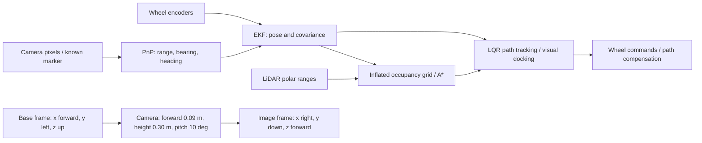
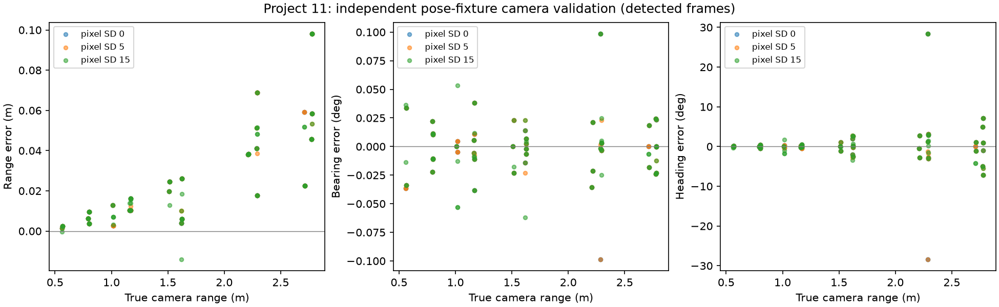
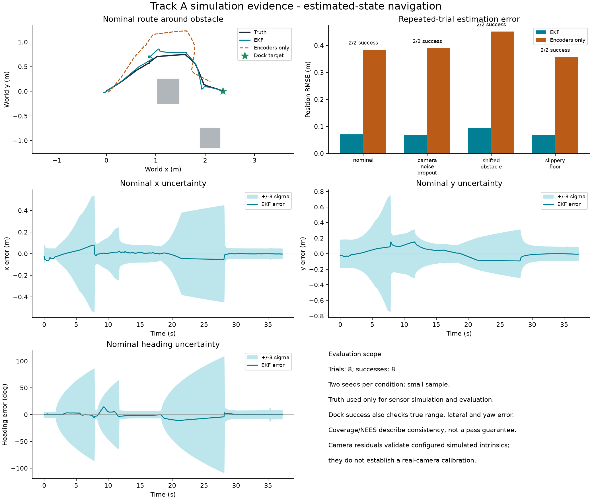

# Project 11 — TurtleBot3 visual waypoint navigation

**41014 Sensors and Control for Mechatronics Systems · Track A · Simulation**

The robot uses LiDAR to navigate around room obstacles, encoder/camera EKF fusion
to estimate its pose, and LQR/state feedback to dock at a known ArUco station.
The controller uses estimated pose, never simulator ground truth. Hardware is optional
and no hardware implementation is claimed here.

## Video and code

- **[Watch/download the 4:45 demo](media/project-11-demo.mp4)** — video included in this repository, with four complete runs, labelled replays, and live estimates/uncertainty alongside truth. The footage-led cut is silent, ready for your own voice-over using the simple timed script; no voice narration is claimed.
- [Direct MP4 file](https://raw.githubusercontent.com/contactbillygardner-cyber/turtlebot3-visual-navigation/codex/track-a-estimation-review/media/project-11-demo.mp4)
- [Source code](robotis_tb3/) · [Demo script and provenance](media/README.md)

The code and video are directly accessible from this public project page, following
the supplied 2 November teaching announcement. This page is on the review branch;
use **[this exact project-page URL](https://github.com/contactbillygardner-cyber/turtlebot3-visual-navigation/tree/codex/track-a-estimation-review)**
for review/submission until the team merges PR #1 into main. This page does not
claim that a Canvas submission or extension approval has been completed.

## Team and contribution record

| Team member | Recorded work and verification status |
|---|---|
| William Gardner | Earlier Part A model/tutorial adaptations present in the repository. Final individual declaration requires team confirmation. |
| Ibrahym Abdillah | Published Part B camera/LiDAR rewrite and sensor write-up, merged from commit 13b9b9f. Final individual declaration requires his confirmation. |
| Ethan Wong | Published Part D LQR, actuator work, tests and write-up, merged from commit 05362e1. His original declaration reports Claude assistance. Final individual declaration requires his confirmation. |
| Ho Youn Garwood | Requested and coordinated Part C preparation, reviews, experiments, integration and presentation through this Codex chat. No independent code execution or validation is claimed; implementation/tool-run experiments and drafting were Codex-assisted. |

Project identifier **11** was supplied by Ho Youn Garwood. This table records
available artifacts and the student's stated activity; it does not invent other
members' manual work or approval. Each member should confirm their final statement.

## Model, frames and pipeline

State `s=[x,y,theta]` is in metres/radians; world/base x is forward, y left and
z up. Measured wheel increments predict differential-drive motion using radius
0.0330 m and track 0.288 m. The loop is 10 Hz and physics is 500 Hz.
Moving-state controllability has rank 3; its local linearisation drops to rank 2
at rest. The camera includes marker-derived heading, so the measurement Jacobian
is full rank away from the marker. Range/bearing alone to one known landmark
would retain a rotational ambiguity. Missing camera observations provide no
absolute correction.



[Full model/frame discussion](robotis_tb3/TRACK_A_PROJECT.md#model-and-frames-part-a)
· [Part A notes](robotis_tb3/PART_A_PROJECT_PAGE.md)

## Sensing and calibration

The camera is 640x480 with vertical FOV 60 degrees and a known 0.22 m marker.
The current detector assumes one known station marker. LiDAR has 360 rays and
3.5 m maximum range; the tested CLI passes 0.006 m range-noise SD. Encoders are
quantised to 1024 counts/revolution with configurable wheel bias.

An independent 24-view checkerboard calibration fitted focal lengths within
0.42% of configured values; six held-out views had mean reprojection RMS 0.064 px.
The unchanged marker detector was evaluated on varied pose/range/noise fixtures:
range RMSE approximately 3.6 cm, heading RMSE 4.8–6.4 degrees, with a remaining
approximately 2.6 cm range bias. These are simulation results, not physical-camera
calibration; they do not prove general detection robustness.

[Calibration protocol, complete results and limits](robotis_tb3/CAMERA_VALIDATION.md)
· [Part B design](robotis_tb3/PART_B_SENSORS.md)



## Estimation and control

The EKF predicts from encoder arcs, corrects with camera range/bearing/heading,
wraps angular innovations, gates outliers and uses a Joseph covariance update.
Q/R are engineering covariance models, not measured universal constants. The
selected run uses Q x10/R x1; residual bias/correlation and constant R remain
limitations. Nine-setting fixed-stream replay is separate from online navigation.

The LQR uses estimated cross-track/heading errors against a latched A* reference.
Its gain is approximately `[6.94,2.54]`; the controller R scale is distinct from
EKF camera R. Path-only feedforward compensation accounts for identified wheel
friction/gain. Rotation entry/exit are 0.8/0.5 rad. Docking keeps the shared state
feedback mapping and requires five accepted camera confirmations. Missing images
cannot add arrival evidence. Saturation and large-angle switching limit the
linear stability argument.

[Part C equations and tuning](robotis_tb3/PART_C_ESTIMATION.md)
· [Part D model and results](robotis_tb3/PART_D_PROJECT_PAGE.md)
· [Integration protocol and parameters](robotis_tb3/INTEGRATION_STATUS.md)

## Integration and quantitative results

Two seeds per condition, 110 s limit, Q x10/R x1, LQR R x1, path compensation,
rotation entry 0.8 rad. Physical success checks include no recorded collision,
true final range within 8 cm of 0.55 m, lateral error below 8 cm and yaw below
0.15 rad. Truth scores results after commands are computed.

| Condition | Success | Mean completion (s) | Mean position RMSE (cm) |
|---|---:|---:|---:|
| Nominal | 2/2 | 36.45 | 7.05 |
| Camera noise SD 5 / 30% dropout | 2/2 | 42.40 | 6.73 |
| Obstacle shifted 0.15 m / encoder bias 0.004 | 2/2 | 37.35 | 9.47 |
| Floor friction 0.6 | 2/2 | 35.50 | 6.91 |

**86 regression tests passed**, including rendered navigation checks and calibration
diagnostic tests. **8/8 full navigation trials completed; zero recorded collisions/timeouts. Mean per-trial position RMSE
7.54 cm.** The 0.8-rad threshold reduced one slow case from 90.3 to 36.9 s,
but increased mean RMSE from 6.20 to 7.54 cm versus the same combined pipeline
at 0.4 rad. This is a speed–accuracy tradeoff. The older 4.90 cm result belongs
to a different sensor/controller configuration. Reused seeds, two runs per case
and a fixed room limit generalisation; this is not an optimality or grade claim.



[Original traces, source snapshots and results](robotis_tb3/evidence/integration-2026-11-01/)
· [Complete evidence index](robotis_tb3/evidence/README.md)

Only studies with published supporting data are relied on here. Historical Part D
compensation/sweep/recovery claims whose batch summaries are missing remain marked
unverified in the detailed draft; they are not presented as verified headline results.

## Install and run from a clean start

Tested with Python 3.14 on macOS arm64. Headless rendering still needs a compatible
graphics environment. From the repository root:

```sh
python3.14 -m venv .venv
.venv/bin/python -m pip install -r requirements-analysis.txt
.venv/bin/python -m pip check
.venv/bin/python -m unittest discover -s robotis_tb3 -p 'test_*.py' -v
.venv/bin/mjpython robotis_tb3/track_a_project.py --controller lqr --compensate path --lqr-rotate-enter .8 --q-scale 10 --r-scale 1 --output run-output/demo
```

Use normal Python for the viewer on other supported platforms. For a headless trial:

```sh
.venv/bin/python robotis_tb3/track_a_project.py --headless --controller lqr --compensate path --lqr-rotate-enter .8 --q-scale 10 --r-scale 1 --output run-output/headless
.venv/bin/python robotis_tb3/lqr/evaluate_controllers.py --controllers lqr@0.8+comp --trials 2 --seconds 110 --q-scale 10 --r-scale 1 --output eval_integrated
.venv/bin/python robotis_tb3/validate_camera.py --output camera-validation-output --seed 11
```

The controller batch rejects stale/unsigned caches; choose a new output directory
when source/settings change. Historical defaults stay 1/1, heuristic and compensation
off; the explicit commands above select the assessed integrated configuration.

A [clean-start reproduction](robotis_tb3/evidence/fresh-start-2026-11-04/)
on 4 November installed these requirements in a new isolated environment, passed
`pip check`, and completed the nominal headless trial in 37.3 s with unchanged
metrics. This checks the fresh installation/run; the GUI viewer was not exercised
in that particular check.

## Sources, generative AI and viva readiness

ROBOTIS robot assets and the subject tutorial adaptations are acknowledged in the
[upstream README](UPSTREAM_README.md) and Part A notes. OpenCV, MuJoCo, Machine Vision
Toolbox and SciPy provide sensing/simulation/numerical APIs. Existing Part C
references explain the established EKF and consistency diagnostics.

**AI declaration:** OpenAI Codex assisted with implementation, debugging, experiments,
tests, plots, integration, camera-validation tooling, project-page drafting and video
composition. New experiments were tool-executed and are not attributed to a student
as personally run. Ethan's Part D declaration reports Claude assistance with LQR,
analysis/code/tests and drafting. Team members must confirm their actual work and
understand all components; AI use is not presented as independent human verification.

The supplied viva announcement requires this public page, a simulation ready to
launch from a clean start, and understanding of models/observability/controllability,
sensors/calibration/noise/EKF, control/visual servoing, and diagnosis/robustness.
The viva is separate from submission. [Student preparation checklist](robotis_tb3/STUDENT_CHECKLIST.txt).
