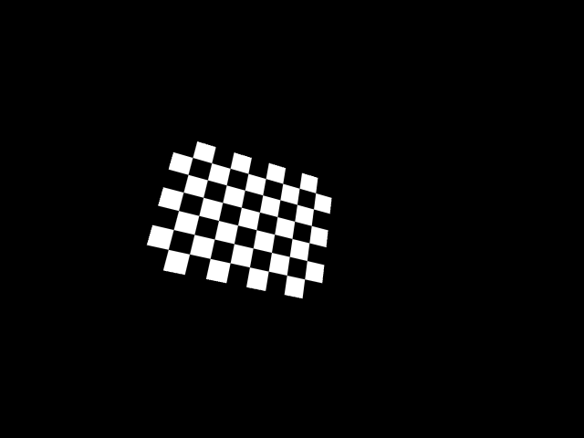
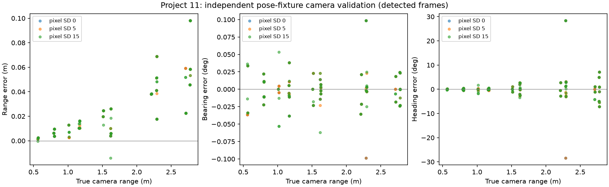

# Camera calibration and validation — Project 11

## Protocol and separation from the controller
This is an offline simulation experiment. Ground truth generates labelled
fixtures and scores sensor output; it is never passed to the navigation controller.
The assessed Part B detector and integrated pipeline were not changed.

The study first estimates camera intrinsics from an independent rendered
checkerboard scene at the same 640x480 resolution and 60-degree vertical FOV.
It uses 24 deterministic board poses (seed 11), a 9x7-square board with 8x6
internal corners, and known square size 0.04 m. Eighteen views fit fx, fy, cx, cy;
the final six are held out of intrinsic fitting. Skew and lens distortion are
fixed to the simulator's zero-distortion pinhole assumptions; distortion was
not independently estimated. Held-out extrinsics are fit by PnP before measuring
reprojection residuals, as distinct from refitting intrinsics on those views.

## Intrinsic calibration results
All 24 boards were detected. Configured fx=fy=415.692 px, cx=319.5, cy=239.5.
Estimated fx=417.171 px, fy=417.399 px, cx=320.112, cy=239.004.
Focal error is 0.356% horizontally and 0.411% vertically; principal-point offsets
are +0.612 and -0.496 px. Training reprojection RMS is 0.074 px. The mean held-out
per-view RMS is 0.064 px (maximum 0.094 px).

This supports the configured simulator intrinsics within the rasterisation and
corner-detection errors of this fixture. It does not establish physical-camera
calibration accuracy. The fitted matrix is not silently substituted into the
controller; published navigation results retain their original configuration.



## Marker range, bearing and heading validation
The unchanged detector processes rendered images at 45 positive-pose fixtures:
five longitudinal positions, three lateral positions and three heading offsets
(-20, 0, +20 degrees from facing the station). Each is repeated twice at each
pixel-noise SD. Fifteen additional poses face 90 degrees away, likewise repeated
twice. There are 360 images total, not 360 navigation trials or independent scenes.
Clean repeats are identical; all fixtures use the same room and known marker.

Truth range uses MuJoCo's actual camera and marker world translations; truth
bearing and yaw use actual base orientation. This independently checks the
camera/base offset and frame conversion without calling the EKF measurement
function to generate the reference. Errors are wrapped for angular comparisons.

| Pixel-noise SD | Detected / positive-pose attempts | Range RMSE (cm) | Bearing RMSE (deg) | Heading RMSE (deg) | Range bias (cm) |
|---:|---:|---:|---:|---:|---:|
| 0 | 90/90 | 3.56 | 0.028 | 6.40 | 2.57 |
| 5 | 90/90 | 3.60 | 0.023 | 4.84 | 2.62 |
| 15 | 90/90 | 3.52 | 0.026 | 4.88 | 2.56 |

For every noise level, all 30 out-of-view attempts returned no observation.
Detection rate is conditional on these chosen fixtures, not a claim about all
occlusions, lighting, ranges or other marker IDs. The detector assumes a sole
known station marker. No wrong-ID robustness claim is made.



## Consequences for EKF tuning
The 2.6 cm mean range bias is systematic and is not removed simply by increasing
R. The approximately 3.6 cm range RMSE is comparable to, but slightly above, the
current 3 cm assumed range standard deviation. Heading RMS of 4.8–6.4 degrees
is below the configured 8-degree heading standard deviation on these fixtures.
The empirical residual covariance in summary.json uses units [m, deg, deg];
convert angular terms to radians before using it as an EKF covariance. Residual
correlations and pose-dependent error mean the diagonal constant R remains an
approximation. These results justify checking that approximation, not claiming
optimal noise values or full estimator consistency. Bias correction/range-dependent
R would require a separate development/validation split and new closed-loop trials.

The raw detector has individual heading errors approaching 30 degrees in these
fixtures, particularly at longer range, despite a much lower overall RMS.
[Range-binned results](evidence/camera-validation-2026-11-04/range-dependence.json)
retain these outliers. The EKF innovation gate provides a further state-dependent
check, but is not guaranteed to reject every erroneous planar pose. A constant
8-degree heading standard deviation does not describe these tails fully.

Noise does not produce a monotonic heading-RMSE trend in this small experiment.
Do not infer that more image noise improves the sensor; geometry, rasterisation,
planar pose ambiguity and limited repetitions need further investigation.

## Reproduction and provenance

```sh
.venv/bin/python robotis_tb3/validate_camera.py --output camera-validation-output --seed 11
.venv/bin/python -m unittest discover -s robotis_tb3 -p 'test_camera_validation.py' -v
```

The [evidence directory](evidence/camera-validation-2026-11-04/) contains the
checkerboard texture/scene, all 24 calibration images and fixture transforms,
360-row marker CSV, summary with per-view held-out residuals and exact source
hashes, and the residual plot. OpenCV corner arrays are normalised before RMS
computation to handle the different N-by-2/N-by-1-by-2 layouts; regression tests
cover this shape mismatch and a known five-pixel displacement.

OpenAI Codex implemented and tool-executed this validation and drafted the report.
No independent human execution or validation is inferred from these tool runs.
