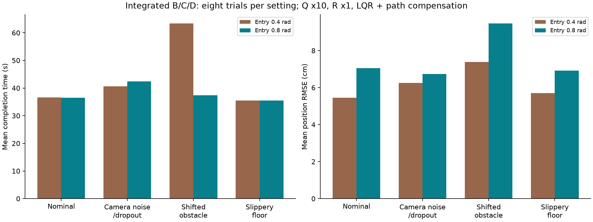
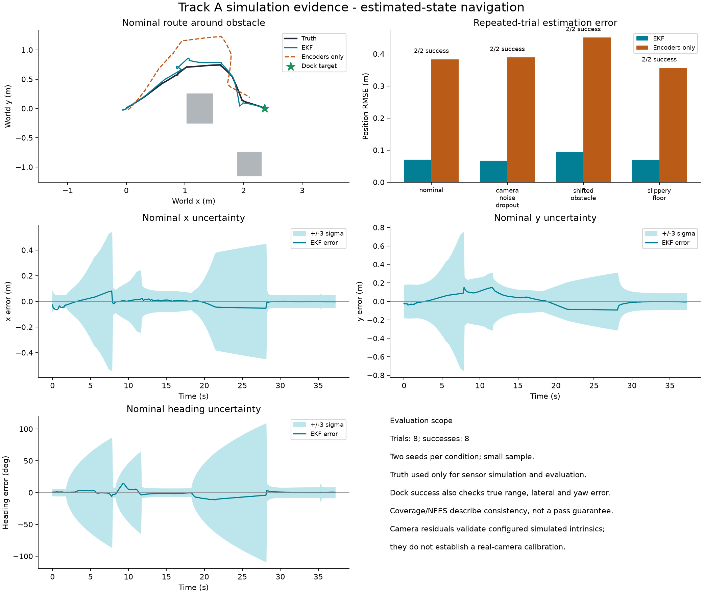

# Integrated B/C/D validation — 1 November 2026

## Included work and repairs
This review branch merges Ibrahym's Part B sensors (`13b9b9f`) and Ethan's Part D
LQR/actuator work (`05362e1`) into the Part C review branch. Earlier Part C evidence
and the batch Q/R regression fix are retained. It does not merge the project into main.

- Resolved `.gitignore`, removed accidental shell heredoc text, and preserved generated-output exclusions.
- Declared and installed the sensor-toolbox, spatialmath and SciPy dependencies.
- Both batch runners now propagate shared runtime options, including EKF Q/R.
  Scenario definitions and controller specs deliberately override their corresponding options.
- The controller runner signs settings/source/model/sensor/package information.
  It resumes matching results and rejects stale/unsigned caches, preserving old evidence.
- Repaired Part D links and labelled unpublished historical numerical studies as pending.
- Updated camera/LiDAR descriptions to the actual Part B configuration.
- **84 regression tests passed**; `pip check` found no broken requirements.

## Selected explicit integration configuration
The tested setup uses EKF **Q x10, R x1**, LQR effort R x1, path-only actuator
compensation, rotation entry **0.8 rad** (exit 0.5 rad), LiDAR noise 0.006 m,
640x480 camera with vertical FOV 60 degrees, and no-path recovery off.
Controller LQR R is distinct from the EKF camera R. Historical defaults remain
unchanged; the launch commands explicitly select this configuration.

The before-run slow shifted-obstacle seed 0 took 90.3 s. Its 15–60 s path phase
contained 107 drive/rotate transitions and 107 turn-sign reversals. Increasing
rotation entry from 0.4 to 0.8 rad reduced the same seed to **36.9 s** and path
rotation time from 31.1 to 1.3 s. This supports a switching/steering interaction
as the cause of the slow behaviour; it is not a general stability proof.
The original small-error LQR analysis does not prove stability through the
larger-angle switching, saturation and sensor dropouts.

## Full online validation
Two seeds (0/1) per condition, 110 s limit, physical docking checks unchanged:

| Condition | Success | Mean time (s) | Mean position RMSE (cm) |
|---|---:|---:|---:|
| nominal | 2/2 | 36.45 | 7.05 |
| camera noise dropout | 2/2 | 42.40 | 6.73 |
| shifted obstacle | 2/2 | 37.35 | 9.47 |
| slippery floor | 2/2 | 35.50 | 6.91 |

All eight completed with **zero recorded collisions and zero timeouts**.
Mean per-trial position RMSE was **7.54 cm**, compared with **6.20 cm** for the
same combined sensor/controller at entry 0.4 rad. The slowest run fell from
90.3 to 45.3 s. This is a speed–accuracy tradeoff, not a uniformly better setting.
The earlier **4.90 cm** result used the older sensor/heuristic configuration and
must not be attributed to this integration.

The 0.8 setting was examined on the slow case, then checked across the eight
runs. An additional targeted 0.6 run took 39.0 s with 10.74 cm position RMSE;
it did not improve that case and was not run as a full batch. These are small,
reused-seed development samples, not untouched holdout validation or an optimality claim.





## Reproduce
Tested with Python 3.14 on macOS arm64. From the repository root:

```sh
python3.14 -m venv .venv
.venv/bin/python -m pip install -r requirements-analysis.txt
.venv/bin/python -m pip check
.venv/bin/python -m unittest discover -s robotis_tb3 -p 'test_*.py' -v
.venv/bin/python robotis_tb3/lqr/evaluate_controllers.py --controllers lqr@0.8+comp --trials 2 --seconds 110 --q-scale 10 --r-scale 1 --output eval_integrated
.venv/bin/python robotis_tb3/lqr/analyse_controllers.py eval_integrated/summary.json --out eval_integrated
```

For the viewer on macOS:

```sh
.venv/bin/mjpython robotis_tb3/track_a_project.py --controller lqr --compensate path --lqr-rotate-enter .8 --q-scale 10 --r-scale 1 --output track-a-output
```

Headless rendering still requires a graphics-capable MuJoCo environment. Other
platforms may use normal Python for the viewer. Use a new output directory when
changing tuning/source; the controller cache rejects old or incompatible results.

## Published provenance and remaining submission items
[Evidence directory](evidence/integration-2026-11-01/) includes original compressed
traces, SHA-256 hashes, exact source snapshots, results, metrics and plots for
both before and final batches. Output paths alone were made repository-relative.
Expand using `python3 robotis_tb3/unpack_evidence.py`, then regenerate the overview:

```sh
.venv/bin/python robotis_tb3/analyse_track_a.py robotis_tb3/evidence/integration-2026-11-01/final
```

The original 80-trial controller summary is present. Historical compensation,
sweep and recovery summaries remain missing; the relevant Part D sections are
explicitly marked unverified rather than inventing or relabelling evidence.
Configured camera intrinsics do not replace quantitative calibration validation.
The team still needs confirmed names/group number/contributions and the five-minute
video with estimates/uncertainty alongside truth, followed by actual Canvas links.

Ibrahym and Ethan retain credit for their branch contributions. OpenAI Codex
assisted with this merge, dependency/runner/cache repairs, tests, tuning experiments,
evidence packaging and documentation. The new integration runs were tool-executed;
they are not attributed to a teammate as personally performed. Human verification
and individual contribution declarations must be confirmed before submission.
