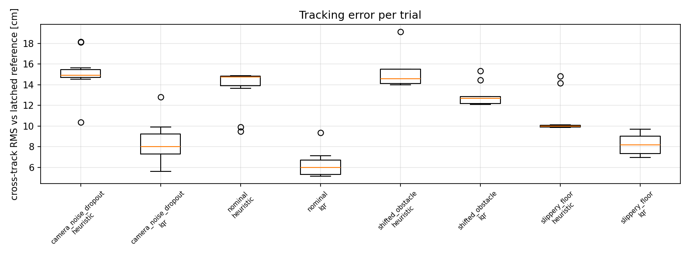

# Part D: estimated-state LQR control

## Design and published evidence
The controller uses the EKF pose to form cross-track and heading errors,
`[e_y, e_theta]`, and applies `w = -K [e_y, e_theta]` with a discrete LQR gain
of approximately `[6.94, 2.54]` at 0.18 m/s. It tracks a latched, straightened
A* reference. Ground truth is used for evaluation only. Docking uses the shared
camera-confirmed state-feedback docking law.

The published [80-trial historical comparison](evidence/part-d/eval_cmp/controller_results.md)
contains 40 LQR and 40 heuristic trials at EKF Q/R 1/1. LQR completed 40/40;
the heuristic completed 35/40. Nominal true cross-track RMS was 6.3 cm versus
13.6 cm. The reference is latched for the LQR, so comparisons have the reference
and selection limitations described in the [full write-up](PART_D_CONTROL.md).

## Integrated configuration
See [integrated validation and commands](INTEGRATION_STATUS.md) for the tested
sensor, estimator, LQR and actuator-compensation configuration. LQR R is a
controller effort weight and is separate from the EKF camera R multiplier.
The old defaults remain available for reproducing the historical comparison;
use the explicit integrated launch command for the new configuration.

The feedforward actuator compensator uses encoder-independent identified
kinematic/friction gains and preserves yaw authority by reducing forward speed
when wheel commands saturate. It is enabled on path following, with the original
mapping during docking (`--compensate path`).

## Evidence limits
The original author reported 120 compensation trials plus sweep/recovery studies,
but the referenced numerical summaries are absent. Those are marked pending in
the full write-up and are not claimed here as verified results. No compensated
heuristic comparison or hardware result is claimed. The new integration trials
are reported separately; they do not establish broad statistical robustness.

## Reproduce
From the repository root, install `requirements-analysis.txt`, then follow
[the integration commands](INTEGRATION_STATUS.md). The controller evaluation
runner checks source/settings before reusing caches and rejects older unsigned
results; use a fresh output directory for a changed experiment.

## Generative AI declaration (Part D) 

> Claude (Anthropic, via claude.ai) was used for Part D to: review the path-error model and LQR design; write and test `lqr/track_a_control.py` (the latched reference path and the LQR tracker), `lqr/evaluate_controllers.py`, `lqr/analyse_controllers.py`, `lqr/part_d_summary.py`, `lqr/plot_tracking.py` and their tests; `lqr/plot_trace.py` and `lqr/sweep_compare.py` (diagnostic plots and the compensated R-sweep comparison); the analysis of the compensator and sweep results; add the opt-in no-path recovery and the rotate-threshold option; diagnose the baseline stall from the saved traces and occupancy grids; and draft sections of `PART_D_CONTROL.md`. Ethan's original declaration states that he ran the historical simulations personally and reviewed and corrected the generated code. New integration experiments and fixes were run with OpenAI Codex assistance; see the integration report. Team members must verify their actual contributions before submission.
